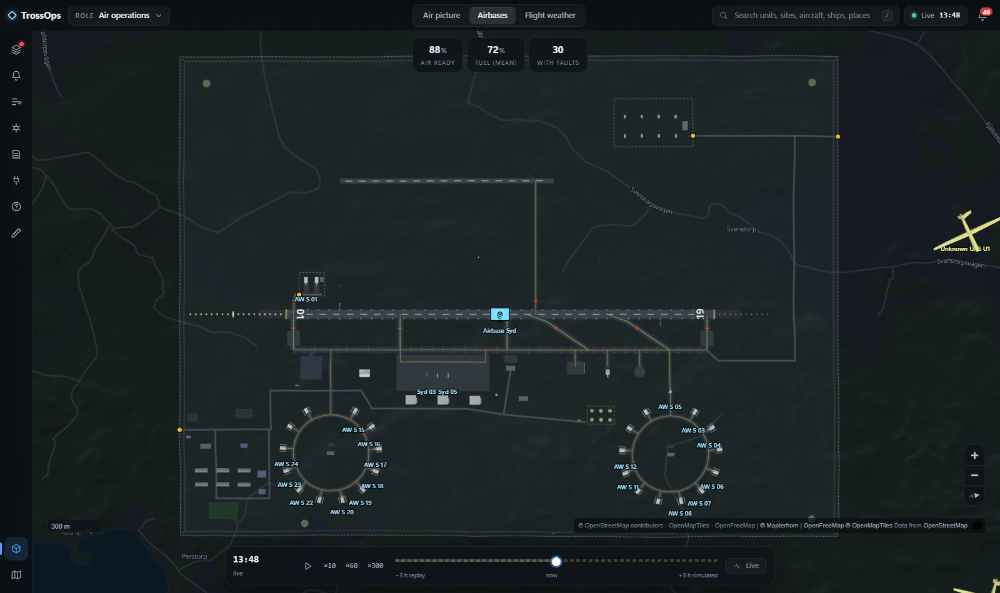
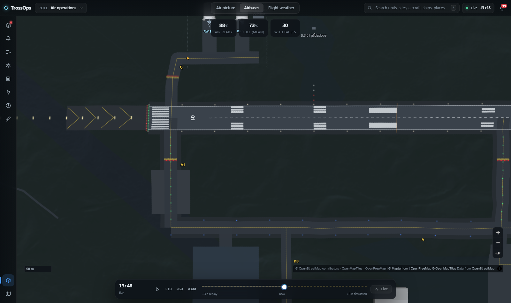
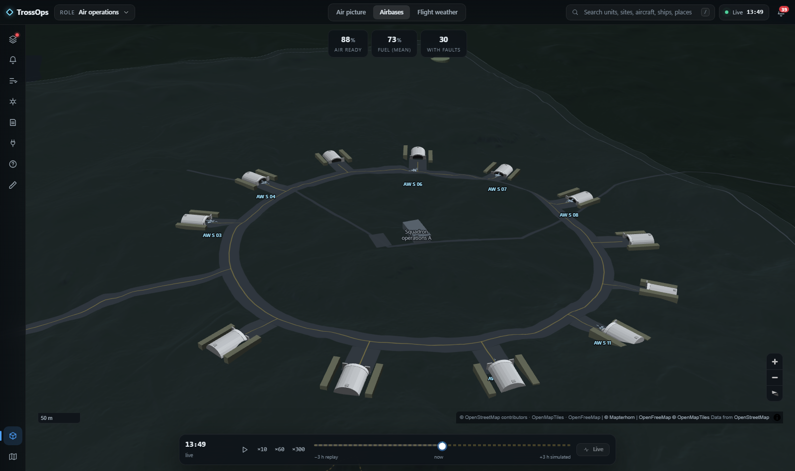
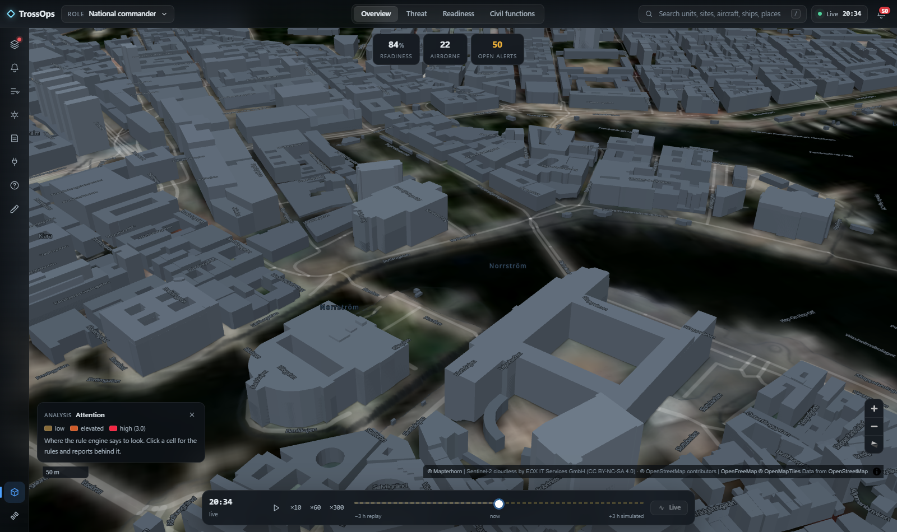
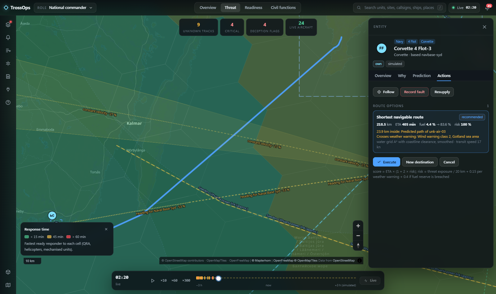
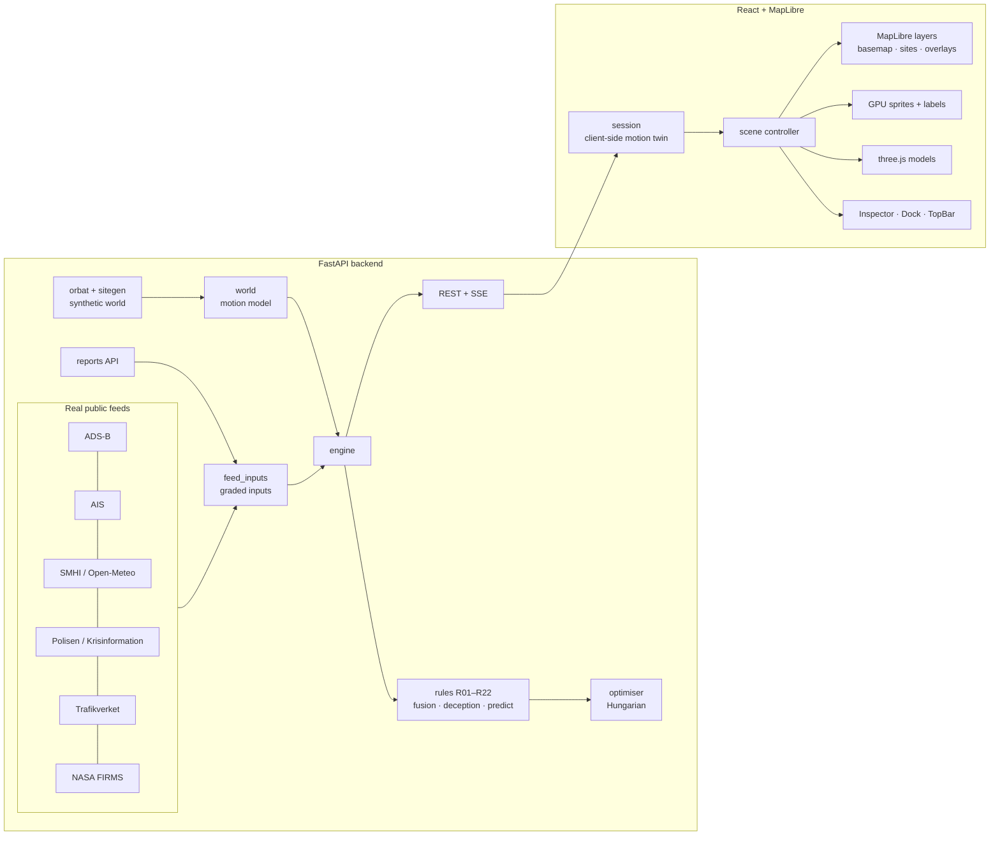

# TrossOps

**A national operational picture for Sweden on one map.** TrossOps fuses a nationwide synthetic order of battle with
real public air, sea, weather, police, crisis, road and fire feeds. A deterministic, explainable rule engine turns
every input into attention, alerts, predictions and costed courses of action. Zoom from the whole country to one
vehicle on its road, or into an airbase where runways, taxiways, shelters, aircraft, fuel and ammunition each sit on
their own layer, in 2D or 3D. No AI in the decision path: every conclusion has a trace.

[](https://trossops.se)
[](LICENSE)


> All military units, sites, routes and reports are **synthetic** and labelled as such. There are no real military
> locations or identities. Real public feeds are marked `real` in the layer tree and the inspector.


| | |
|---|---|
|  |  |
|  |  |
|  |  |
|  |  |

**Live:** [trossops.se](https://trossops.se), deployed from `main` (Stockholm region).

---

## Contents

[Capabilities](#capabilities) · [Integrations](#integrations) · [Tech stack](#tech-stack) ·
[Getting started](#getting-started) · [Usage](#usage) · [Architecture](#architecture) ·
[Project structure](#project-structure) · [Testing](#testing) · [Deployment](#deployment) ·
[Roadmap and limitations](#roadmap-and-known-limitations) · [Licence](#licence)

## Capabilities

### The picture
- **Order of battle at national scale.** About 1,020 platforms in 267 formations across 42 sites, every one moving on
  a deterministic, replayable motion model:
  - air wings fly sorties and training circuits from their shelters;
  - brigades road-march on the real road network;
  - flotillas patrol on water routes;
  - the Home Guard protects critical objects in its own county from outside their fences;
  - police cars and ambulances drive real city streets.
- **Plausible ground truth.** Every site is placed on dry ground clear of roads, using a land/water mask built from
  OpenStreetMap water polygons and rasterised road networks. Parked units stand on land, ships only at sea, ground
  paths cross water only on bridges and ferries. The test suite pins all of this.
- **NATO APP-6 symbology with zoom by echelon.** Formations collapse into one symbol while their units fit together
  on screen and open into battalions, companies and vehicles as they spread out, inside a per-zoom symbol budget.
  At street zoom in 2D a platform is drawn true to scale and heading.
- **Real public traffic beside the synthetic picture.** Live aircraft (ADS-B) with military flags, emergency squawks
  and GNSS-integrity clusters; live ships (AIS) with history trails.

### Sites, down to the last taxiway
Procedural, deterministic layouts for airbases, naval bases, garrisons, depots and sensor sites, split into
**Infrastructure, Logistics, Defence and Personnel** sub-layers.

The airbase is the most detailed:
- **Runway:** shoulders, blast pads with chevrons, piano keys, touchdown-zone and aiming-point markings, designators
  and arresting gear.
- **Lighting:** approach, edge, threshold and end lights, PAPI, blue taxiway edges, green centrelines and red stop bars.
- **Taxiways:** a named system (parallel A, connectors A1–A4, 30° rapid exits B1/B2) with runway-holding positions
  and arm/de-arm pads at both ends.
- **Aprons and pads:**
  - a stand-marked apron with lead-in lines and hydrant fuel pits;
  - de-icing, engine run-up and compass-swing pads;
  - a hush house and a fire and rescue station.
- **Dispersal:** loops of hardened shelters on short spurs between earth revetments, and a fenced QRA compound with
  its own taxiway straight onto the runway.
- **Navaids:** ILS localizer and glideslope, TACAN, weather station and approach radar.
- **Support areas:**
  - a reserve road strip;
  - a separately fenced weapons storage area with gates;
  - a fuel farm with per-tank fill level;
  - a landside cantonment;
  - guard towers, air-defence emplacements and a perimeter patrol road.

**Aircraft use the airfield like aircraft.** They taxi by shortest path on the taxiway graph, through the arming pad,
to line-up. They take off, fly their mission, land, roll out onto the rapid exit nearer their stand, taxi back and
park nose-out. Fuel bowsers shuttle between the fuel farm and the flight line, and a security patrol drives the
perimeter.

### 2D and 3D in one renderer
- **One camera, one selection, one clock** across 2D and 3D (MapLibre GL JS with custom WebGL layers; see ADR-001).
- **57 procedural 3D models.** Fighters, transports, helicopters, armour, trucks, warships, civil shipping, shelters,
  hangars, towers, radars and more, all generated in code with no third-party assets. Aircraft climb, turn and bank
  from the motion model.
- **3D cities.** Extruded buildings in both the Dark and the Imagery basemaps, with contact shadows and lighting.
  Terrain is exaggerated for relief at national scale and true scale at city zoom.
- **Basemaps.** Dark (operational), Imagery (Sentinel-2) and Offline (no network at all). Labels and symbols are GPU
  layers, so a moving picture never stalls the map.

### Fusion that explains itself
- **21 deterministic rules (R01–R22)** turn the world and every input into attention, alerts, interventions and
  predictions, each with its trace. They cover:
  - unknown tracks, readiness, faults, comms and infrastructure outages;
  - civil emergencies, weather, intelligence and area coverage;
  - command directives, stale reporting and monitoring of committed interventions;
  - small UAS near protected sites, maritime anomalies over undersea cables, GNSS interference;
  - emergency squawks, pattern indicators on real traffic, real road situations and real thermal anomalies.

  See [rules.md](docs/geospatial/rules.md).
- **The inspector shows its reasoning:**
  - **Why:** sources graded on the NATO Admiralty scale, corroboration and identity hypotheses.
  - **Prediction:** competing trajectory hypotheses with probabilities.
  - **Deception:** named indicators with log-odds weights, including thermal corroboration of explosion and fire
    reports from NASA FIRMS.
  - **Actions:** costed intervention options with success bands.
- **Optimiser.** Assigns units to open interventions with no unit double-booked (Hungarian assignment), weighing
  severity, ETA and success.
- **Reports from any channel.** Field reports, police, intelligence, public news, allied liaison, directives up to
  head-of-state level. Each is parsed, graded, attached to entities by reference or position, and fed to the rules.

### Analysis and planning
- **Analysis surfaces on H3 hexagons**, one at a time, every cell explaining itself:
  - fusion attention;
  - threat reach of unknown tracks;
  - sensor and air-defence coverage;
  - response time;
  - flight conditions from real weather;
  - GNSS interference from real ADS-B.
- **Route planning.** Pick a destination and get options by road, water or air, each with ETA, fuel and exposure to
  threat corridors and weather warnings. Ground routes avoid live road incidents. With Lantmäteriet credentials each
  option also gets a terrain profile, and air options a terrain-clearance check. Executing an option makes the unit
  move.
- **Map tools.** Measure, line of sight, range ring and a cursor elevation readout on Lantmäteriet terrain.

### Time, scenarios and roles
- **Simulation clock.** Run at ×10 to ×300, replay the past and look ahead.
- **Six scenario presets** to inject and watch the rules react:
  - drone swarm over an airbase;
  - undersea cable damage east of Gotland;
  - inbound air raid;
  - GNSS jamming in the southern Baltic;
  - regional power outage in Mälardalen;
  - disinformation about Göteborg port.
- **Ten roles and 22 modes.** Each mode is a curated layer preset, camera and KPI row. The roles:
  - national commander;
  - air operations;
  - maritime operations;
  - army operations;
  - intelligence;
  - police and emergency services;
  - civil defence;
  - logistics;
  - regional commanders South and North.

  A 58-layer tree overrides any mode.

### Honest status everywhere
Every feed, layer and integration uses one vocabulary: `working`, `partial`, `simulated`, `adapter-only`, `planned`
or `blocked`. A keyed feed without its key reports `adapter-only`; it is never mocked.

## Integrations

The **Data sources** drawer (`I`) and `GET /api/sources` show each feed's live status. Full matrix:
[integration-matrix.md](docs/geospatial/integration-matrix.md).

| Feed (id) | Status | Key | Licence |
|---|---|---|---|
| Aircraft: adsb.lol, OpenSky fallback (`adsb`) | working | optional `OPENSKY_CLIENT_ID` / `OPENSKY_CLIENT_SECRET` | ODbL / OpenSky terms |
| Ships: Digitraffic (`ais-digitraffic`) | working (northern Baltic and Bothnia only) | none | CC BY 4.0 |
| Ships: AISStream (`aisstream`) | working with key, else adapter-only | `AISSTREAM_API_KEY` | AISStream terms |
| SMHI observations, warnings (`smhi-obs`, `smhi-warnings`) | working | none | CC BY 4.0 |
| Open-Meteo grid (`open-meteo`) | working | none | CC BY 4.0, non-commercial |
| RainViewer radar (`rainviewer`) | working | none | free tier |
| Polisen events (`polisen`), Krisinformation (`krisinformation`) | working | none | public APIs |
| NOAA SWPC Kp (`swpc-kp`) | working | none | public domain |
| Trafikverket road situations (`trafikverket`) | working with key, else adapter-only | `TRAFIKVERKET_API_KEY` | Trafikverket open data |
| NASA FIRMS active fires (`firms`) | working with key, else adapter-only | `FIRMS_MAP_KEY` | NASA open data |
| Lantmäteriet Markhöjd Direkt terrain (`lm-markhojd`) | working with key, else adapter-only (terrain endpoints return 503) | `LANTMATERIET_USERNAME` / `LANTMATERIET_PASSWORD` | Lantmäteriet, free |
| Basemap, terrain, imagery, 3D buildings: OpenFreeMap, Mapterhorn, EOX Sentinel-2 | working (browser) | none | ODbL; open; CC BY-NC-SA |
| Order of battle, sites, reports, scenario | simulated | — | synthetic |

## Tech stack

| Layer | Technology |
|---|---|
| Backend | Python 3.12+, FastAPI, Uvicorn, httpx, SQLite (event store), pytest |
| World model | Deterministic motion model (Python, with a TypeScript twin pinned by shared fixtures), procedural site generator, road/sea/street routing on bundled graphs |
| Frontend | React 19, TypeScript 5.9, Vite 7, Vitest |
| Map and 3D | MapLibre GL JS 6.14 (camera, terrain, basemaps, extrusions), three.js 0.186 in a custom layer, GPU sprite and text layers, h3-js, milsymbol (APP-6) |
| Browser tests | Playwright |
| Hosting | Vercel (static frontend + one Python function, region `arn1`) |

## Getting started

### Prerequisites
- Python **3.12+**. On Windows, use a native CPython from python.org or `py`; MSYS2 Python can't build some wheels.
- Node.js **20+** and npm.
- Git.

### Install

```powershell
git clone https://github.com/EUDIS2026/TrossOps.git
cd TrossOps

# backend, in a virtual environment
py -3.12 -m venv .venv            # or: python3 -m venv .venv
.\.venv\Scripts\Activate.ps1      # macOS/Linux: source .venv/bin/activate
python -m pip install -r backend\requirements.txt

# frontend
cd frontend; npm ci; cd ..
```

### Configure

Copy `.env.example` to `backend/.env` (gitignored, loaded at start-up). Real environment variables win over the file.

| Variable | Effect |
|---|---|
| `TROSSOPS_FEEDS=off` | no network calls; every feed reports `blocked` (tests, offline demos) |
| `TROSSOPS_START_S` | scenario seconds at start (600 gives a populated picture) |
| `TROSSOPS_CLOCK_SPEED` | scenario speed multiplier (default 1) |
| `TROSSOPS_EPOCH` | `hourly` (serverless: instances agree on the epoch) or an ISO timestamp |
| `TROSSOPS_DB_PATH` | SQLite store for commits and events (default `backend/data/trossops.sqlite`; `/tmp` on Vercel) |
| `AISSTREAM_API_KEY`, `TRAFIKVERKET_API_KEY`, `FIRMS_MAP_KEY` | enable the keyed feeds above |
| `OPENSKY_CLIENT_ID`, `OPENSKY_CLIENT_SECRET` | OpenSky OAuth for the ADS-B fallback |
| `LANTMATERIET_USERNAME`, `LANTMATERIET_PASSWORD` | Geotorget account for Markhöjd Direkt (alternatives: `LANTMATERIET_CLIENT_ID` / `LANTMATERIET_CLIENT_SECRET`, or `LANTMATERIET_TOKEN`) |

### Run

```powershell
# terminal 1: API on :8000
cd backend; python -m uvicorn app.main:app --host 127.0.0.1 --port 8000 --reload

# terminal 2: UI on :5173 (proxies /api to :8000)
cd frontend; npm run dev
```

Open http://127.0.0.1:5173. On Windows, `scripts\run-windows.ps1` starts both in the background and logs to
`_logs\`.

## Usage

### In the UI
1. Pick a **role** (top left) and a **mode** (top centre). The map, layers, camera and KPIs follow.
2. Click any symbol to open the **inspector**: Why, Prediction, Deception and Actions for tracks; Overview,
   Inventory and Alerts for sites.
3. Select an airbase, press `3` for 3D, and zoom in to watch aircraft taxi, take off and land.
4. Press `S` to run time faster or inject a scenario, then follow the alerts (`A`) and decisions (`D`).

Shortcuts:

| Key | Action |
|---|---|
| `/` | search |
| `L` | layers |
| `A` | alerts |
| `D` | decisions |
| `S` | time and scenarios |
| `R` | new report |
| `I` | data sources |
| `T` | map tools: measure `M`, line of sight `V`, range ring `C`, elevation `E` |
| `3` | 3D |
| `F` | follow |
| `Space` | pause or resume |
| `Esc` | close |
| `Home` | reset |

### API examples

```bash
curl http://127.0.0.1:8000/api/health                                      # status, clock, rule count
curl "http://127.0.0.1:8000/api/scene/snapshot?at=700&role=national_commander"
curl http://127.0.0.1:8000/api/sites/airbase-syd/layout                    # full site layout (GeoJSON + spots)
curl http://127.0.0.1:8000/api/entities/airbase-syd                        # entity detail, alerts, based platforms
curl http://127.0.0.1:8000/api/sources                                     # live status of every feed

# post a field report and watch the rules attach it
curl -X POST http://127.0.0.1:8000/api/inputs -H "content-type: application/json" \
  -d '{"channel":"field_report","authorLevel":"soldier","author":"Pvt Test","title":"Drone over depot-mitt","text":"Unknown drone observed over depot-mitt perimeter"}'

# inject a scenario preset
curl -X POST http://127.0.0.1:8000/api/scenario/inject -H "content-type: application/json" -d '{"preset":"drone_swarm"}'
```

The full contract is in [api-contracts.md](docs/geospatial/api-contracts.md). There are about 45 endpoints covering
world, scene, entities, inputs, alerts, interventions, planning, scenarios, environment, live feeds, terrain and a
server-sent event stream.

## Architecture



- **Deterministic world.** The backend builds the synthetic world once from seeds. The server and the browser
  evaluate the same motion model, so the browser animates at display rate without polling positions. Expensive
  routes and site placements are cached in `backend/data/world_routes.json.gz`.
- **One rendering stack.** MapLibre owns the camera, terrain, basemap, fills, extrusions and picking. Two custom
  WebGL layers draw moving symbols and labels, and a three.js layer draws 3D models in MapLibre's depth buffer
  (see [ADR-001](docs/decisions/ADR-001-geospatial-renderers.md) and
  [ADR-002](docs/decisions/ADR-002-national-picture-v2.md)).
- **Explainable rules.** Every alert, intervention and attention cell carries the rule, inputs and numbers that
  produced it.

More detail: [architecture.md](docs/geospatial/architecture.md).

## Project structure

```
backend/
  app/            orbat · sitegen (site layouts, taxiway graph) · motion · world · geonet (land/water, road graphs)
                  rules · fusion · deception · predict · planner · optimize · scenario · engine · feeds/ · main
  data/           geo/ (national road graph, city street graphs, sea, land and road masks) · world_routes.json.gz
  tests/          pytest suite with recorded feed fixtures
frontend/
  src/contracts/  API types
  src/core/       api, clock, motion twin, world, session, store
  src/scene/      controller, basemap, overlays, sprites, text, models3d, three/ (procedural models), analysis,
                  terrain, camera, tools
  src/ui/         TopBar, Dock, Inspector, tools
  scripts/        verify-browser.mjs (Playwright acceptance run)
api/index.py      Vercel entry for the FastAPI app
scripts/          Windows setup/run helpers · data/ (reproducible build of the geo artefacts)
docs/             product · briefs · decisions (ADRs) · geospatial (architecture, API, rules, integrations, styles)
```

## Testing

```powershell
cd backend;  $env:TROSSOPS_FEEDS="off"; python -m pytest -q     # 186 tests, no network
cd frontend; npm run typecheck; npm test; npm run build          # 82 unit tests
cd frontend; $env:BROWSER_CHANNEL="msedge"; npm run verify       # browser acceptance; needs API and UI running
```

`npm run verify` drives the real UI:
- loads without console errors;
- switches every role and mode, and opens every Dock panel;
- compares the Sources drawer against `/api/sources`;
- opens the Inspector via search and requests route options;
- toggles 3D, computes the analysis surfaces and runs the simulation clock, among other steps.

Options:
- `TROSSOPS_UI` sets the URL.
- `VERIFY_READONLY=1` skips the steps that write to the backend.
- `VERIFY_ONLY=E2E-04,E2E-09` runs a subset.

Use a hardware GPU (`BROWSER_CHANNEL=msedge`, or Chromium with `--use-angle=d3d11`), because headless software
WebGL is too slow for the 3D steps.

## Deployment

`vercel.json` builds `frontend/` as the static site and serves the FastAPI backend as one Python function
(`api/index.py`, 60 s max) in region **`arn1`** (Stockholm). Every push to `main` deploys. `TROSSOPS_EPOCH=hourly`
and `TROSSOPS_START_S=600` are set in `vercel.json`. Feed keys go in the Vercel project's environment variables.
Commits are stored per serverless instance (`/tmp`).

## Roadmap and known limitations

**Planned:**
- airbase-grade layouts for every other site kind: naval bases, garrisons, depots, sensor sites, HQ, field
  hospitals, comms and telecom nodes, substations, ports and bridge-crossing centres;
- sharp 16 cm Lantmäteriet orthophotos and real building heights from Lantmäteriet laser data;
- a richer 3D city with roofs, night lighting, trees and shadows.

**Not planned:** Google Photorealistic 3D Tiles. Google refuses them for projects billed in the EEA, and its terms
exclude this kind of use.

**Known limitations:**
- AIS from Digitraffic covers only the northern Baltic and the Gulf of Bothnia; national ship coverage needs an
  AISStream key.
- Imagery is 10 m Sentinel-2, so it is soft at city zoom.
- Many OpenStreetMap buildings have no height and show as uniform low blocks.
- On Vercel, serverless instances each keep their own commits and vessel caches.
- `test_feeds.py::test_aisstream_adapter_only_without_key_and_message_parsing` uses a fixed timestamp that is now
  older than the feed's 30-minute retention, so it fails until the fixture is dated relative to now.

## Contributing

This is a proprietary, source-available project. Issues and suggestions are welcome. Contributions are accepted
only under the contribution terms in [LICENSE](LICENSE) (section 4).

Working agreement ([AGENTS.md](AGENTS.md)):
- many small conventional commits (`feat`, `fix`, `test`, `perf`, `docs`, `chore`);
- the backend tests and frontend typecheck stay green at every commit;
- the status vocabulary is used everywhere;
- every operational entity is synthetic.

## Licence

**Source-available, all rights reserved.** See [LICENSE](LICENSE). You may read the code. You may not use, copy,
modify, deploy or distribute it, commercially or otherwise, without written permission from the copyright holder;
this includes companies, government bodies and research institutions. Licensing enquiries:
[trossops.se](https://trossops.se).

Versions up to and including commit `0d6943a` were published under the PolyForm Noncommercial License 1.0.0. Map
data and public feeds keep their own licences (see [Integrations](#integrations)).

## Author

**shafir-01** (Shafir Khajo).
