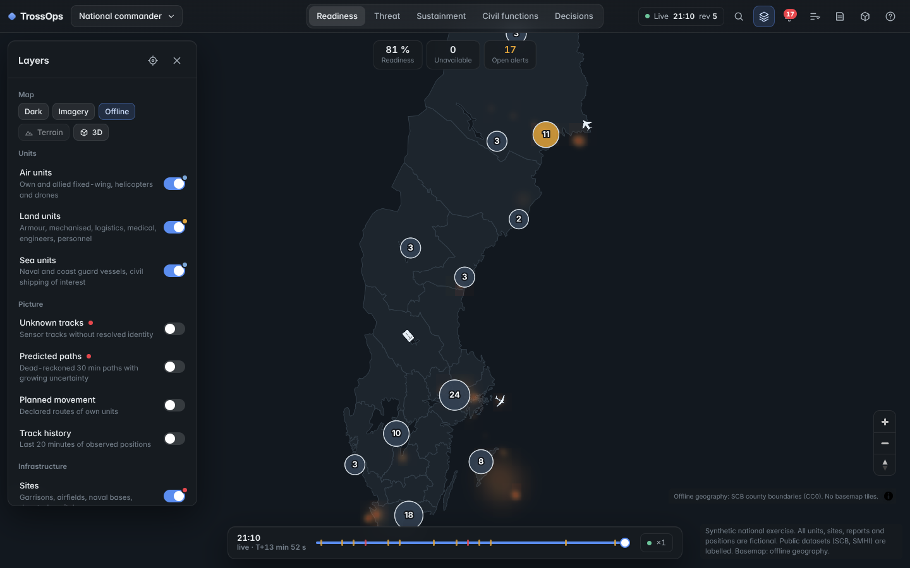

# TrossOps

National-level operational picture for Sweden: one map, role-based views, mode-based maps, separable 2D/3D layers, and a deterministic rule engine that turns every input channel into attention, alerts, interventions with outcome bands, predictions and an optimised plan. No AI in the demo path.

All operational content is **synthetic** and labelled. Public datasets (SCB county boundaries, SMHI forecasts, OpenFreeMap/OpenStreetMap, Mapterhorn, EOX Sentinel-2) are the only real data.

- Product: [`docs/product/vision.md`](docs/product/vision.md) · Brief: [`docs/briefs/`](docs/briefs/)
- Decisions: [`docs/decisions/ADR-001-geospatial-renderers.md`](docs/decisions/ADR-001-geospatial-renderers.md)
- Architecture, rules, styles, API, verification, integration matrix, demo: [`docs/geospatial/`](docs/geospatial/)



## Run

Backend (Python 3.12+):

```powershell
python -m pip install -r backend\requirements.txt
cd backend
$env:TROSSOPS_START_S = "600"   # optional: start the scenario ten minutes in
python -m uvicorn app.main:app --host 127.0.0.1 --port 8000
```

Frontend (Node 20+):

```powershell
cd frontend
npm install
npm run dev
```

Open http://127.0.0.1:5173. Shortcuts: `/` search · `L` layers · `A` alerts · `D` decisions · `R` report · `3` 3D · `F` follow · `Home` reset · `?` help.

## Check

```powershell
cd backend;  python -m pytest -q
cd frontend; npm run typecheck; npm test; npm run build; npm run verify
```

`npm run verify` drives a real browser through eleven acceptance steps against the running API and UI and writes screenshots plus a results ledger to `frontend/test-results/`.

## Deploy (Vercel)

The repository is ready for Vercel as it stands: `vercel.json` builds `frontend/` as the static site and serves the FastAPI
backend as one Python function (`api/index.py`, dependencies in the root `requirements.txt`).

- Dashboard: **Add New → Project → Import `EUDIS2026/TrossOps`**, keep the detected settings, Deploy.
- CLI, from the repository root: `npx vercel` (first run links the project), then `npx vercel --prod`.

Serverless limits to know: each instance has its own SQLite store under `/tmp`, so committed interventions and field reports
are per-instance and vanish on cold start; `TROSSOPS_EPOCH=hourly` makes every instance agree on scenario time and restarts
the scenario each hour. The `/api/stream` SSE connection is capped at 60 s and reconnects. A single always-on process
(`uvicorn`, as in **Run**) is the faithful deployment; Vercel is for sharing the demo.

## Layout

```
backend/app   geo · models · world · inputs · rules · predict · attention · optimize · views · engine · weather · main
frontend/src  contracts · core (api, store, session, entityBuffer) · scene (controller, sprites, models3d, semantics, basemap) · ui
docs          product · briefs · decisions · geospatial
```
