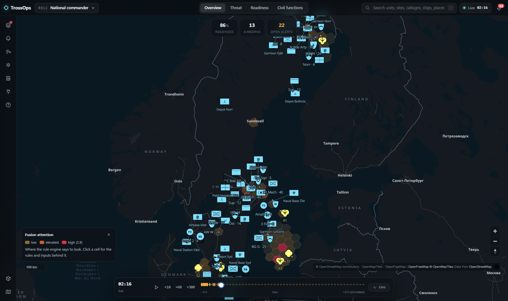
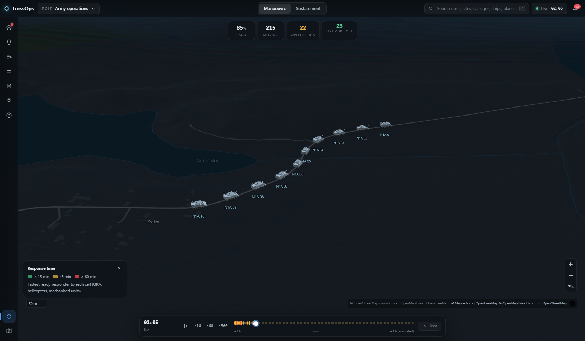
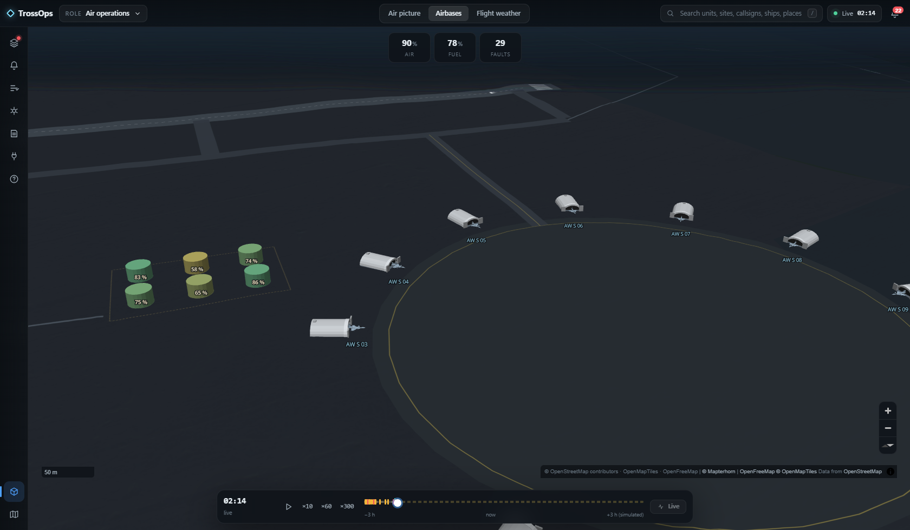
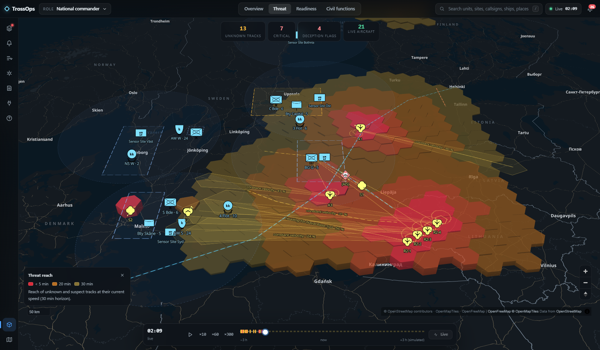
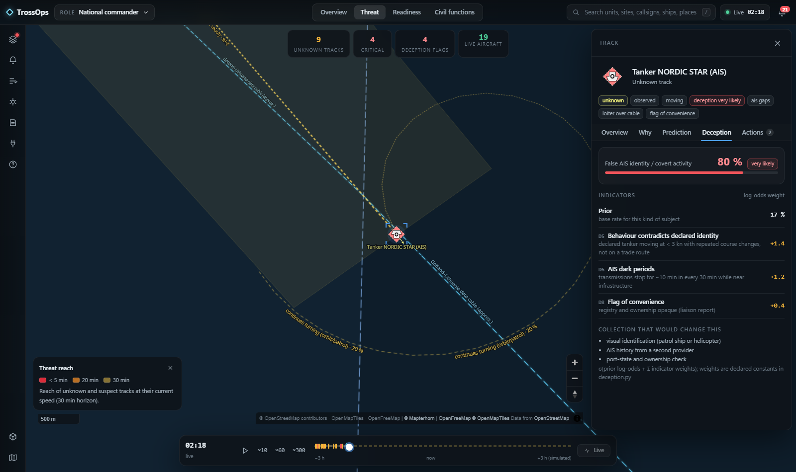

# TrossOps

A national operational picture for Sweden on one map. The defence is a **synthetic** order of battle at national scale;
a deterministic rule engine fuses every input channel, including **real** public air and sea traffic, weather, police,
crisis, road and fire feeds. Zoom from the national picture to a single vehicle on its road, or into an airbase where
shelters, aircraft, fuel and ammunition each sit on their own layer. No AI in the demo path.

All units, sites, routes and reports are synthetic and labelled as such; no real military locations or identities.
Real public feeds are marked `real` in the layer tree and the inspector.



| | |
|---|---|
|  |  |
|  |  |

## What it does

- **Order of battle at national scale.** About 1,020 platforms in 267 formations and 42 sites: air wings fly sorties
  from their shelters, brigades road-march on the real road network, flotillas patrol on water routes, the Home Guard
  protects critical sites, police cars and ambulances drive real city streets. Sites stand on dry, road-free ground,
  parked units on land, ships only at sea (land/water mask built from OpenStreetMap water polygons).
- **Zoom by echelon.** Formations collapse into one NATO APP-6 symbol while their units fit together on screen and
  open into battalions, companies and vehicles as they spread out, inside a per-zoom symbol budget.
- **Site detail and 3D.** Procedural layouts for airbases, naval bases, garrisons and depots on their own detail
  layers; 53 procedural 3D models with attitude on terrain; a cinematic fly-in and orbit when a site is selected.
- **Fusion that explains itself.** The inspector shows **Why** (sources graded on the Admiralty scale, corroboration,
  identity hypotheses), **Prediction** (competing trajectory hypotheses with probabilities), **Deception** (named
  indicators with log-odds weights) and **Actions**.
- **19 rules (R01–R20)** produce attention, alerts, interventions and predictions, each with its trace;
  the optimiser assigns units to interventions (Hungarian). See [rules](docs/geospatial/rules.md).
- **Analysis surfaces** on H3 hexagons: fusion attention, threat reach, sensor and air-defence coverage, response time,
  flight conditions (real weather) and GNSS interference (real ADS-B). One at a time.
- **Route planning.** Pick a destination: options on roads, water or in the air with ETA, fuel, and exposure to threat
  corridors and weather warnings; ground routes avoid live road incidents; with Lantmäteriet credentials each option
  also gets a terrain profile and air options a terrain-clearance check. Executing an option makes the unit move.
- **Map tools (`T`).** Measure (`M`), line of sight (`V`), range ring (`C`) and a cursor elevation readout (`E`).
  Line of sight and elevation use Lantmäteriet terrain and say "not configured" when the server has no credentials.
- **Simulation.** Run at ×10 to ×300, replay the past, look ahead; inject six scenario presets (drone swarm, cable
  damage, air raid, GNSS jamming, power outage, disinformation) and watch the rules react.
- **Roles and modes.** Ten roles (national, air, maritime, army, intelligence, police, civil defence, logistics, two
  regional commanders), 22 modes, each a curated layer preset and camera; the layer tree overrides it.

## Integrations

Status words are the project vocabulary (`working`, `partial`, `simulated`, `adapter-only`, `planned`, `blocked`).
The **Data sources** drawer (`I`) and `GET /api/sources` show each feed's live status; a keyed feed without its key is
`adapter-only`, never mocked. Full matrix: [integration-matrix.md](docs/geospatial/integration-matrix.md).

| Feed (id) | Status | Key | Licence |
|---|---|---|---|
| Aircraft: adsb.lol, OpenSky fallback (`adsb`) | working | optional `OPENSKY_CLIENT_ID` / `OPENSKY_CLIENT_SECRET` | ODbL / OpenSky terms |
| Ships: Digitraffic (`ais-digitraffic`) | working (northern Baltic and Bothnia only) | none | CC BY 4.0 |
| Ships: AISStream (`aisstream`) | working with key, else adapter-only | `AISSTREAM_API_KEY` | AISStream terms |
| SMHI observations, warnings (`smhi-obs`, `smhi-warnings`) | working | none | CC BY 4.0 |
| Open-Meteo grid (`open-meteo`) | working | none | CC BY 4.0, non-commercial |
| RainViewer radar (`rainviewer`) | working | none | free tier |
| Polisen events (`polisen`), Krisinformation (`krisinformation`) | working | none | public APIs |
| NOAA SWPC Kp (`swpc-kp`) | working | none | public domain |
| Trafikverket road situations (`trafikverket`) | working with key, else adapter-only | `TRAFIKVERKET_API_KEY` | Trafikverket open data |
| NASA FIRMS active fires (`firms`) | working with key, else adapter-only | `FIRMS_MAP_KEY` | NASA open data |
| Lantmäteriet Markhöjd Direkt terrain (`lm-markhojd`) | working with key, else adapter-only (terrain endpoints return 503) | `LANTMATERIET_USERNAME` / `LANTMATERIET_PASSWORD` | Lantmäteriet, free |
| Basemap, terrain, imagery: OpenFreeMap, Mapterhorn, EOX Sentinel-2 | working (browser) | none | ODbL; open; CC BY-NC-SA |
| Order of battle, sites, reports, scenario | simulated | — | synthetic |

## Quick start

```powershell
python -m pip install -r backend\requirements.txt
cd backend; $env:TROSSOPS_START_S = "600"; python -m uvicorn app.main:app --host 127.0.0.1 --port 8000
cd frontend; npm ci; npm run dev        # http://127.0.0.1:5173 (proxies /api to :8000)
```

`scripts\run-windows.ps1` starts both in the background and logs to `_logs\`.

### Environment

Set in the shell or in a gitignored `backend/.env` (loaded at start-up).

| Variable | Effect |
|---|---|
| `TROSSOPS_FEEDS=off` | no network calls; every feed reports `blocked` (tests, offline demos) |
| `TROSSOPS_START_S` | scenario seconds at start (600 gives a populated picture) |
| `TROSSOPS_CLOCK_SPEED` | scenario speed multiplier (default 1) |
| `TROSSOPS_EPOCH` | `hourly` (serverless: instances agree on the epoch) or an ISO timestamp |
| `TROSSOPS_DB_PATH` | SQLite store for commits and events (default `backend/data/trossops.sqlite`; `/tmp` on Vercel) |
| `AISSTREAM_API_KEY`, `TRAFIKVERKET_API_KEY`, `FIRMS_MAP_KEY` | enable the keyed feeds above |
| `OPENSKY_CLIENT_ID`, `OPENSKY_CLIENT_SECRET` | OpenSky OAuth for the ADS-B fallback |
| `LANTMATERIET_USERNAME`, `LANTMATERIET_PASSWORD` | Geotorget account for Markhöjd Direkt (alternatives: `LANTMATERIET_CLIENT_ID` / `LANTMATERIET_CLIENT_SECRET`, or `LANTMATERIET_TOKEN`) |

Shortcuts: `/` search · `L` layers · `A` alerts · `D` decisions · `S` time & scenarios · `R` new report · `I` sources · `T` map tools · `3` 3D ·
`F` follow · `Space` pause/resume · `Esc` close · `Home` reset.

## Check

```powershell
cd backend;  $env:TROSSOPS_FEEDS="off"; python -m pytest -q            # 166 tests, no network
cd frontend; npm run typecheck; npm test; npm run build                # 72 unit tests
cd frontend; $env:BROWSER_CHANNEL="msedge"; npm run verify             # browser smoke, needs API + UI running
```

`npm run verify` (`scripts/verify-browser.mjs`) drives the real UI: load without console errors, every role and mode,
every Dock panel, Sources vs `/api/sources`, Inspector via search, route options, 3D toggle, analysis surfaces,
simulation clock and more. `TROSSOPS_UI` sets the URL (default `http://127.0.0.1:5173/`); `VERIFY_READONLY=1` skips
the steps that write to the backend; `VERIFY_ONLY=E2E-04,E2E-09` runs a subset. Screenshots and `results.json` go to
`frontend/test-results/`.

## Deploy (Vercel)

`vercel.json` builds `frontend/` as the static site and serves the FastAPI backend as one Python function
(`api/index.py`, 60 s max) in region **`arn1`** (Stockholm). The project is connected to this GitHub repository, so
every push to `main` deploys. `TROSSOPS_EPOCH=hourly` and `TROSSOPS_START_S=600` are set in `vercel.json`; feed keys
go in the Vercel project's environment variables. Commits are stored per serverless instance (`/tmp`).

## Layout

```
backend/app    orbat · sitegen · motion · world · geonet · rules · fusion · deception · predict · planner ·
               optimize · scenario · engine · feeds/ · feed_inputs · routes_live · main
backend/data   geo/ (national road graph, city street graphs, sea.bin, land.bin) · world_routes.json.gz (route cache)
frontend/src   contracts/types.ts · core (api, clock, motion, world, session, store) · scene (controller, sprites,
               symbols, models3d, three/, analysis, overlays, basemap, camera, windfield) · ui (TopBar, Dock, Inspector)
scripts/data   reproducible build of the road, street, sea and land/water artefacts
docs           product · briefs · decisions (ADR-001, ADR-002) · geospatial (architecture, api-contracts, rules,
               integration-matrix, demo, verification)
```

## Licence

[PolyForm Noncommercial 1.0.0](LICENSE) — source-available, free for noncommercial use (personal, research,
educational, charitable and government institutions). Commercial use needs a separate licence from the copyright
holder. Required notice: Copyright Shafir Khajo (https://trossops.se). Map data and public feeds keep their own
licences (see the integrations table).
